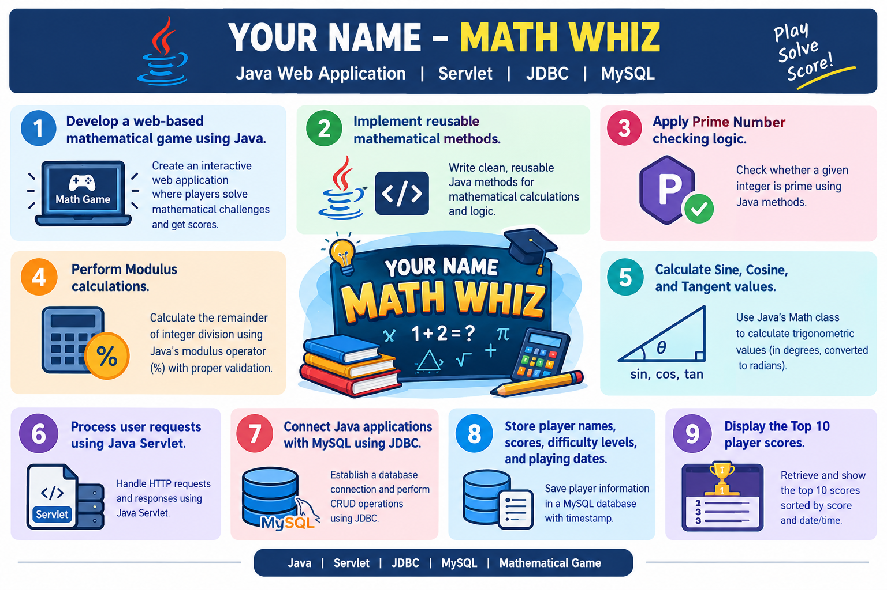

# 🎮 Ashikur – MATH WHIZ
### Java Web Application Development | Lab Practice: Java Servlet & JDBC

A web-based mathematical game developed using **Java, Java Servlet, JSP, JDBC, and MySQL**.

The application presents four mathematical challenges covering Prime Numbers, Modulus Operations, and Trigonometry. It evaluates answers using actual Java mathematical methods, calculates scores out of 10, stores player information in a MySQL database, and displays a Top 10 leaderboard.

---

# 📌 Table of Contents

1. [Project Overview](#-1-project-overview)
2. [Project Objectives](#-2-project-objectives)
3. [Technologies Used](#-3-technologies-used)
4. [Mathematical Functions](#-4-mathematical-functions)
5. [Game Rules and Scoring System](#-5-game-rules-and-scoring-system)
6. [Application Screenshots](#-6-application-screenshots)
7. [Database Design Using JDBC](#-7-database-design-using-jdbc)
8. [Top 10 Leaderboard](#-8-top-10-leaderboard)
9. [Testing and Validation](#-9-testing-and-validation)
10. [Software Requirements](#-10-software-requirements)
11. [Installation and Setup](#-11-installation-and-setup)
12. [Project Structure and Source Code](#-12-project-structure-and-source-code)
13. [Learning Outcomes](#-13-learning-outcomes)
14. [Developer Information](#-14-developer-information)
15. [GitHub Repository](#-15-github-repository)
16. [License](#-16-license)

---

## 📌 1. Project Overview

| Information | Details |
|---|---|
| Project Name | Ashikur – MATH WHIZ |
| Project Type | Java Web Application |
| Project Category | Academic Lab Assignment |
| Difficulty Level | NORMAL |
| Total Questions | 4 |
| Maximum Marks | 10 |
| Backend | Java Servlet |
| Frontend | JSP, HTML, CSS |
| Database | MySQL |
| Connectivity | JDBC |
| Server | Apache Tomcat |

### Project Description

The main objective of this project is to develop an interactive mathematical game where players enter their names, solve four mathematical questions, submit their answers, and receive scores based on their performance.

The system automatically evaluates answers using reusable Java methods and stores player results in a MySQL database.

### Project Overview Screenshot



---

## 🎯 2. Project Objectives

- Develop a web-based mathematical game using Java.
- Implement reusable mathematical methods.
- Apply Prime Number checking logic.
- Perform Modulus calculations.
- Calculate Sine, Cosine, and Tangent values.
- Process user requests using Java Servlet.
- Connect Java applications with MySQL using JDBC.
- Store player names, scores, difficulty levels, and playing dates.
- Display the Top 10 player scores.

### Objectives Screenshot


---

## 🛠️ 3. Technologies Used

| Technology | Purpose |
|---|---|
| Java | Programming Language |
| Java Servlet | Server-side Processing |
| JSP | Dynamic Web Pages |
| JDBC | Database Connectivity |
| MySQL | Database Management |
| HTML5 | Web Page Structure |
| CSS3 | Web Page Styling |
| Apache Tomcat | Web Application Server |
| IntelliJ IDEA | Development Environment |
| Maven | Dependency Management (if used) |

### Development Environment


---

## 🧮 4. Mathematical Functions

The game includes three mathematical areas and four questions.

### 4.1 Prime Number Function

**Method:**

```java
public static int isPrime(int number)
```

**Description:**

- Accepts an integer.
- Checks whether the number is prime.
- Returns `1` if the number is prime.
- Returns `0` otherwise.
- Numbers less than 2 are not prime.

**Example:**

| Input | Output |
|---|---:|
| 7 | 1 |
| 8 | 0 |
| 1 | 0 |
| 13 | 1 |

**Source Code:** [View Prime Number Function](src/main/java/service/MathService.java)

**Screenshot:**


### 4.2 Modulus Function

**Method:**

```java
public static int calculateMod(int a, int b)
```

**Description:**

- Accepts two integer operands.
- Calculates the remainder using `%`.
- Handles division by zero appropriately.
- Returns the calculated remainder.

**Example:**

| Expression | Output |
|---|---:|
| 17 % 5 | 2 |
| 20 % 3 | 2 |
| 10 % 2 | 0 |
| 15 % 4 | 3 |

**Source Code:** [View Modulus Function](src/main/java/service/MathService.java)

**Screenshot:**


### 4.3 Trigonometric Functions

**Methods:**

```java
public static double calculateSin(double degree);

public static double calculateCos(double degree);

public static double calculateTan(double degree);
```

**Description:**

- Accepts angles in degrees.
- Converts degrees into radians.
- Uses Java's built-in `Math` class.
- Calculates sine, cosine, and tangent.
- Handles undefined tangent values appropriately.

**Mathematical Formula:**

\[
\text{Radians} = \text{Degrees} \times \frac{\pi}{180}
\]

**Java Math Methods:**

```java
Math.sin(radians);
Math.cos(radians);
Math.tan(radians);
```

**Example:**

| Function | Input | Expected Output |
|---|---:|---:|
| Sin | 30° | 0.5 |
| Cos | 60° | 0.5 |
| Tan | 45° | 1.0 |

Decimal answers are compared using an appropriate tolerance.

**Source Code:** [View Trigonometric Functions](src/main/java/service/MathService.java)

**Screenshot:**


---

## 🎮 5. Game Rules and Scoring System

Players must enter their names and answer four mathematical questions.

### Question Distribution

| Question | Mathematical Area | Marks |
|---|---|---:|
| Q1 | Prime Number | 2 |
| Q2 | Modulus Operation | 2 |
| Q3 | Trigonometry | 3 |
| Q4 | Trigonometry | 3 |
| **Total** | | **10** |

### Important Rules

1. Prime numbers return `1`; non-prime numbers return `0`.
2. Modulus accepts integer operands only.
3. The modulus divisor must not be zero.
4. Trigonometric input uses degrees.
5. Degrees must be converted into radians.
6. Decimal answers are checked using an appropriate tolerance.
7. All questions are evaluated using actual Java calculations.

### Scoring Logic

```java
int totalScore = 0;

if (primeCorrect) totalScore += 2;
if (modCorrect)   totalScore += 2;
if (trig1Correct) totalScore += 3;
if (trig2Correct) totalScore += 3;
```

**Maximum Score: 10 Marks**

**Game Rules Screenshot:**


---

## 🖥️ 6. Application Screenshots

### 6.1 Welcome Page

The welcome page allows players to enter their names and start the game.


### 6.2 Game Page

The game page displays four mathematical questions with answer input fields.


### 6.3 Result Page

The result page displays the player's name and final score out of 10.


### 6.4 Leaderboard Page

The leaderboard displays the ten highest player scores retrieved from the database.


---

## 🗄️ 7. Database Design Using JDBC

**Database Name:** `math_whiz_db`

**Table Name:** `game_scores`

### 7.1 Database Table Structure

| Field | Data Type | Description |
|---|---|---|
| id | INT | Primary Key, Auto Increment |
| player_name | VARCHAR(100) | Player Name |
| score | INT | Final Score |
| difficulty | VARCHAR(20) | Difficulty Level |
| played_at | TIMESTAMP | Playing Date and Time |

### 7.2 Create Database

```sql
CREATE DATABASE math_whiz_db;

USE math_whiz_db;
```

### 7.3 Create Table

```sql
CREATE TABLE game_scores (
    id INT AUTO_INCREMENT PRIMARY KEY,
    player_name VARCHAR(100) NOT NULL,
    score INT NOT NULL,
    difficulty VARCHAR(20) NOT NULL,
    played_at TIMESTAMP DEFAULT CURRENT_TIMESTAMP
);
```

### 7.4 JDBC Operations

The application uses JDBC to:

- Establish a MySQL database connection.
- Insert player information.
- Save final scores.
- Retrieve saved player records.
- Execute SQL queries using `PreparedStatement`.

**Source Code:** [View ScoreDAO.java](src/main/java/dao/ScoreDAO.java)

**Database Screenshot:**


**JDBC Connection Screenshot:**


---

## 🏆 8. Top 10 Leaderboard

The application displays the ten highest scores from the MySQL database.

### SQL Query

```sql
SELECT *
FROM game_scores
ORDER BY score DESC, played_at ASC
LIMIT 10;
```

### Sorting Rules

1. Higher scores appear first.
2. For equal scores, earlier playing times appear first.
3. Only the top 10 records are displayed.

### Leaderboard Information

- Player Name
- Score
- Difficulty Level
- Playing Date and Time

**Source Code:** [View ScoreDAO.java](src/main/java/dao/ScoreDAO.java)

**Leaderboard Screenshot:**


---

## 🧪 9. Testing and Validation

The application is tested using different mathematical inputs.

| Test Case | Expected Result |
|---|---|
| Prime input: 7 | 1 |
| Prime input: 8 | 0 |
| Prime input: 1 | 0 |
| Modulus: 17 % 5 | 2 |
| Sine: 30° | 0.5 |
| Cosine: 60° | 0.5 |
| Tangent: 45° | 1.0 |
| Divisor: 0 | Validation Error |
| All answers correct | 10 Marks |
| Incorrect answers | Corresponding marks not awarded |

### Testing Results


---

## ⚙️ 10. Software Requirements

The following software is required to run this application:

- JDK 17 or compatible Java version.
- IntelliJ IDEA or Eclipse IDE.
- Apache Tomcat Server.
- MySQL Server.
- MySQL Connector/J.
- Web Browser.
- Maven (if the project uses Maven).

---

## 🚀 11. Installation and Setup

Follow the steps below to run the project on your computer.

### Step 1: Clone the Repository

```bash
git clone https://github.com/YOUR_USERNAME/Math-Whiz.git
```

### Step 2: Open the Project

Open the downloaded project in IntelliJ IDEA or another Java IDE.

### Step 3: Configure JDK

Configure the installed JDK in your IDE.

### Step 4: Configure MySQL Database

1. Start MySQL Server.
2. Open MySQL Workbench or MySQL Command Line.
3. Execute the SQL file from the `database` directory.
4. Verify that the database and table have been created.

**Database SQL:** [View math_whiz_db.sql](database/math_whiz_db.sql)

### Step 5: Configure JDBC Connection

Update the database connection settings in your Java database connection class.

Example:

```java
String url = "jdbc:mysql://localhost:3306/math_whiz_db";
String username = "root";
String password = "YOUR_PASSWORD";
```

Replace `YOUR_PASSWORD` with your local MySQL password.

**Important:** Never upload your actual database password or other private credentials to GitHub.

### Step 6: Configure Apache Tomcat

Configure the Tomcat server in your IDE and deploy the web application.

### Step 7: Run the Application

Start the Tomcat server and open the application in your browser.

**Project Setup Screenshot:**


---

## 📂 12. Project Structure and Source Code

The following structure represents the suggested Java Servlet/JSP application.

### 12.1 Complete Project Structure

```text
Math-Whiz/
│
├── src/
│   └── main/
│       ├── java/
│       │   ├── controller/
│       │   │   └── GameServlet.java
│       │   │
│       │   ├── model/
│       │   │   └── GameScore.java
│       │   │
│       │   ├── service/
│       │   │   └── MathService.java
│       │   │
│       │   └── dao/
│       │       └── ScoreDAO.java
│       │
│       └── webapp/
│           ├── index.jsp
│           ├── game.jsp
│           ├── result.jsp
│           ├── leaderboard.jsp
│           └── css/
│               └── style.css
│
├── database/
│   └── math_whiz_db.sql
│
├── screenshots/
│   ├── home.png
│   ├── game.png
│   ├── result.png
│   └── leaderboard.png
│
├── README.md
├── .gitignore
└── pom.xml
```

### 12.2 Java Source Files

| File Name | Description | Source Code |
|---|---|---|
| GameServlet.java | Handles game requests and responses | [View Code](src/main/java/controller/GameServlet.java) |
| GameScore.java | Stores player score information | [View Code](src/main/java/model/GameScore.java) |
| MathService.java | Contains mathematical methods | [View Code](src/main/java/service/MathService.java) |
| ScoreDAO.java | Handles JDBC database operations | [View Code](src/main/java/dao/ScoreDAO.java) |

### 12.3 JSP Pages

| File Name | Description | Source Code |
|---|---|---|
| index.jsp | Welcome page | [View Code](src/main/webapp/index.jsp) |
| game.jsp | Mathematical game page | [View Code](src/main/webapp/game.jsp) |
| result.jsp | Final score page | [View Code](src/main/webapp/result.jsp) |
| leaderboard.jsp | Top 10 leaderboard page | [View Code](src/main/webapp/leaderboard.jsp) |

### 12.4 CSS Files

| File Name | Description | Source Code |
|---|---|---|
| style.css | Application styling | [View Code](src/main/webapp/css/style.css) |

### 12.5 Database Files

| File Name | Description | Source Code |
|---|---|---|
| math_whiz_db.sql | Database and table creation | [View SQL](database/math_whiz_db.sql) |

### 12.6 Project Configuration

| File Name | Description | Source Code |
|---|---|---|
| pom.xml | Maven project configuration | [View Configuration](pom.xml) |
| .gitignore | Git ignored files configuration | [View File](.gitignore) |

### Project Structure Screenshot


---

## 📚 13. Learning Outcomes

After successfully completing this project, the following skills have been developed:

- Developing reusable Java methods.
- Applying mathematical logic and calculations.
- Using conditional statements and decision-making.
- Understanding Servlet request and response processing.
- Developing dynamic web pages using JSP.
- Implementing JDBC database connectivity.
- Performing database CRUD operations.
- Using `PreparedStatement` for secure database operations.
- Retrieving and sorting database records.
- Developing a leaderboard system.
- Managing and documenting projects using GitHub.

### Source Code Screenshot


---

## 👨‍💻 14. Developer Information

| Information | Details |
|---|---|
| Name | YOUR NAME |
| Department | Information and Communication Technology (ICT) |
| University | Mawlana Bhashani Science and Technology University (MBSTU) |
| Project Title | YOUR NAME – MATH WHIZ |
| Course | Java Web Application Development |
| Project Type | Lab Assignment |

---

## 🔗 15. GitHub Repository

### Repository Link

[Visit GitHub Repository](https://github.com/YOUR_USERNAME/Math-Whiz)

### Project Directory Link

[View Math-Whiz Project Directory](https://github.com/YOUR_USERNAME/Math-Whiz/tree/main)

### Source Code Directory

[Explore Java Source Code](https://github.com/YOUR_USERNAME/Math-Whiz/tree/main/src/main/java)

---

## 📜 16. License

This project was developed for academic and educational purposes as part of a Java Web Application Development Lab Assignment.

---

### ⭐ YOUR NAME – MATH WHIZ

**Developed using Java, Servlet, JSP, JDBC, and MySQL.**

*Academic Project | Java Web Application Development*
